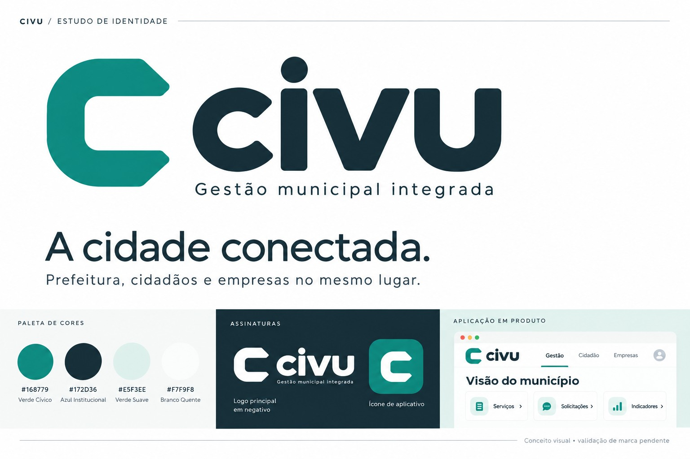

# Identidade visual da Civu

Fonte: Documento Mestre do Produto v1.0 (29/10/2026). É um estudo visual: vetores finais, família tipográfica oficial, domínio e registro da marca continuam pendentes.

- **Nome:** Civu. **Descrição:** Gestão municipal integrada.
- **Frases:** "A cidade conectada." e "Prefeitura, cidadãos e empresas no mesmo lugar."
- **Tom:** clareza, proximidade e confiança.
- **Aplicações:** Civu Gestão, Civu Cidadão e Civu Empresas.

| Cor | Código | Aplicação |
| --- | --- | --- |
| Verde Cívico | `#168779` | Ações principais, identidade e estados positivos |
| Azul Institucional | `#172D36` | Texto forte, navegação e contraste |
| Verde Suave | `#E5F3EE` | Superfícies discretas e apoio visual |
| Branco Quente | `#F7F9F8` | Fundos e áreas de leitura |

**Logo:** símbolo "C" em Verde Cívico com o miolo recortado, ao lado da palavra "civu" em minúsculas no Azul Institucional. Assinaturas: logo principal em negativo sobre o azul e ícone de aplicativo (C branco em quadrado verde de cantos arredondados).

**No sistema:** para texto sobre branco e botões, o código usa o verde mais escuro `#106B60` (contraste mínimo de acessibilidade); o Verde Cívico fica para preenchimentos sem texto. Fontes em uso: Manrope (títulos) e IBM Plex Sans (texto).
